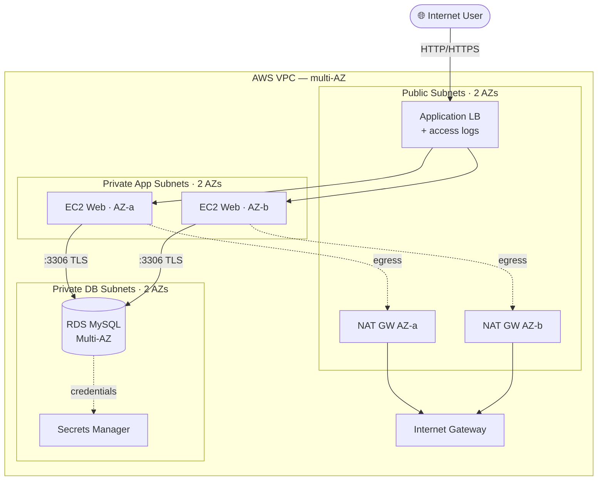

# AWS 3-Tier Highly-Available Web Application (Terraform)

> Production-grade, modular, multi-AZ 3-tier architecture on AWS — remote state, dev/prod environments, CI with security scanning, and least-privilege security throughout.
> **Author:** Muhammad Ahmad · **IaC:** Terraform (modular) · **Cloud:** AWS


---

## 🏗️ Architecture

> 🎨 **Interactive diagram (industry-standard icons):** [open in Lucid — page 1](https://lucid.app/lucidchart/3da75ce3-ea66-4296-81b3-00d20a60435b/edit)



## 📦 Module layout

```
terraform/
├── backend.tf                # remote S3 state + DynamoDB lock (bootstrap notes)
├── main.tf                   # composes the modules
├── variables.tf              # typed, validated inputs
├── environments/
│   ├── dev.tfvars
│   └── prod.tfvars
└── modules/
    ├── network/              # VPC, 2×(public/app/db) subnets, 2 NAT GW (HA), flow logs
    ├── security/             # ALB → Web → DB security groups (least privilege)
    ├── compute/              # ALB (access logs, HTTPS-ready), launch template, ASG, autoscaling
    └── database/             # RDS Multi-AZ, Secrets Manager, enhanced monitoring, alarms
```

## ✨ Production features

- **High availability** — resources span 2 AZs, with **one NAT gateway per AZ**.
- **Secrets** — the DB password is generated and stored in **AWS Secrets Manager** (never in code/state as plaintext input).
- **Encryption** — encrypted EBS and RDS storage; **TLS enforced** on RDS (`require_secure_transport`).
- **Observability** — VPC **flow logs**, RDS **enhanced monitoring** + **Performance Insights**, CloudWatch **alarms**.
- **Hardening** — IMDSv2 required, ALB **access logs** to S3, `drop_invalid_header_fields`, prod **deletion protection**.
- **CI** — GitHub Actions runs `fmt`, `validate`, **TFLint**, **tfsec**, and **Checkov** on every PR.

## 🚀 Deploy

```bash
cd terraform
terraform init
terraform plan  -var-file=environments/dev.tfvars
terraform apply -var-file=environments/dev.tfvars     # or prod.tfvars
```

> Remote state: bootstrap an S3 bucket + DynamoDB lock table, then uncomment `backend.tf` and run `terraform init -migrate-state`.

## 🧹 Clean up

```bash
terraform destroy -var-file=environments/dev.tfvars
```

## 💰 Cost note

ALB, NAT gateways (×2), and RDS Multi-AZ bill hourly and are **not free-tier**. Use `dev.tfvars` (single-AZ DB) for cheap demos and `destroy` when done.

---

*Built and maintained by **Muhammad Ahmad**.*
