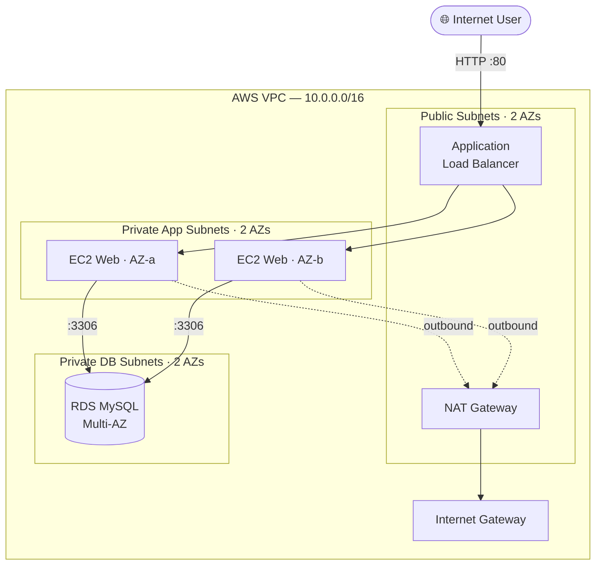

# AWS 3-Tier Highly-Available Web Application (Terraform)

> Production-style, multi-AZ 3-tier architecture on AWS, fully provisioned with Terraform.
> **Author:** Muhammad Ahmad · **IaC:** Terraform · **Cloud:** AWS


---

## 📌 Overview

This project deploys a classic, resilient **3-tier web application** across **two Availability Zones** for high availability:

- **Web / Presentation tier** — an internet-facing **Application Load Balancer** distributing traffic to an **Auto Scaling Group** of EC2 instances running nginx.
- **Application tier** — EC2 instances live in **private subnets** (no public IPs); outbound internet access goes through a **NAT Gateway**.
- **Data tier** — an **Amazon RDS for MySQL** instance with **Multi-AZ** failover, isolated in dedicated private DB subnets.

Security is layered so each tier only accepts traffic from the tier in front of it.

## 🏗️ Architecture

> 🎨 **Interactive diagram (industry-standard icons):** [open in Lucid — page 1](https://lucid.app/lucidchart/3da75ce3-ea66-4296-81b3-00d20a60435b/edit)



## 🧱 What Terraform provisions

| Layer | Resources |
|-------|-----------|
| Networking | VPC, Internet Gateway, 2× public / 2× app / 2× DB subnets, NAT Gateway, route tables |
| Security | 3 security groups (ALB → Web → DB) with least-privilege rules |
| Load balancing | Application Load Balancer, target group, HTTP listener, health checks |
| Compute | Launch Template (Amazon Linux 2023 + IMDSv2), Auto Scaling Group, CPU target-tracking policy |
| Database | RDS MySQL 8.0, Multi-AZ, encrypted storage, 7-day backups, private DB subnet group |

## 🚀 Deploy

**Prerequisites:** Terraform ≥ 1.5, AWS credentials configured (`aws configure`).

```bash
cd terraform
cp terraform.tfvars.example terraform.tfvars   # edit values as needed

# Provide the DB password securely (do not commit it)
export TF_VAR_db_password='YourStrongPassword123!'

terraform init
terraform plan
terraform apply
```

When the apply finishes, open the `application_url` output in a browser — refresh a few times and you'll see requests served by different instances / AZs.

```bash
terraform output application_url
```

## 🧹 Clean up

```bash
terraform destroy
```

## 💰 Cost note

Uses small/`t3.micro`-class resources, but **ALB, NAT Gateway, and RDS Multi-AZ are not free-tier** and bill hourly. Run `terraform destroy` when you're done to avoid charges.

## 🔐 Production hardening (next steps)

- Store the DB password in **AWS Secrets Manager** instead of a variable.
- Add an **HTTPS listener** with an ACM certificate and redirect HTTP → HTTPS.
- Restrict ALB ingress to a WAF / known CIDRs.
- Enable **RDS enhanced monitoring** and deletion protection.

---

*Built and maintained by **Muhammad Ahmad**.*
