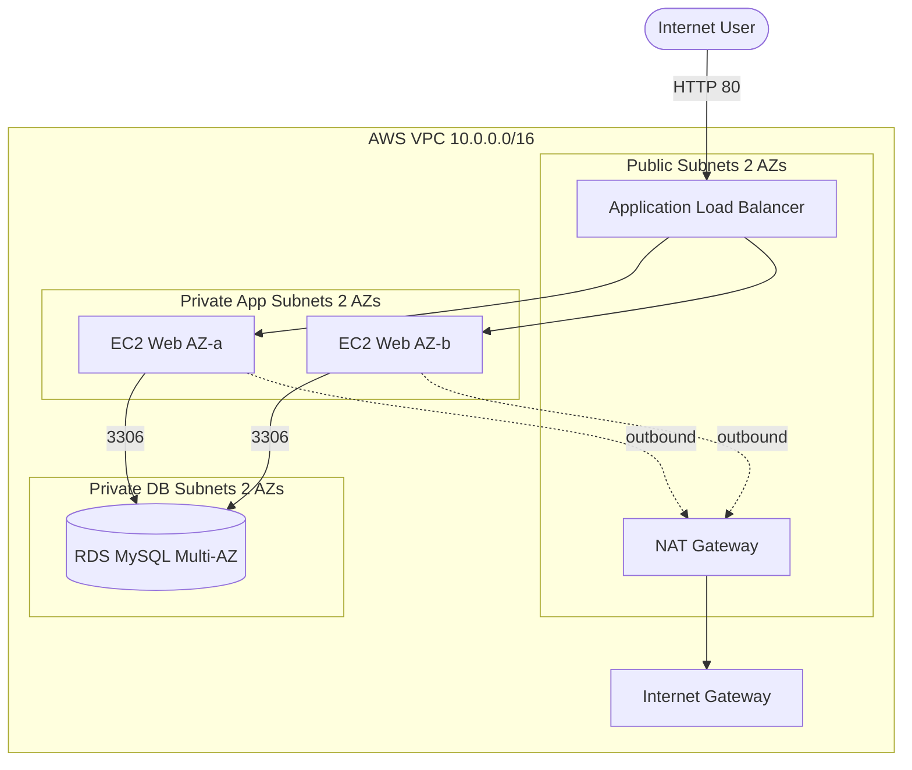

# Architecture Diagram — AWS 3-Tier HA Web App

This folder documents the architecture for the recording/walkthrough.

- A **Lucid diagram** is generated for this project (polished, for screen recording).
- The **Mermaid source** below also renders directly in the GitHub README.

## Lucid diagram

- **Master Lucid document (all 30 diagrams, icon style):** https://lucid.app/lucidchart/3da75ce3-ea66-4296-81b3-00d20a60435b/edit
- This project is **page 1** of that document.

(Created via the Lucid connector. Open to refine styling / add AWS icons before recording.)

## Lucid prompt (reusable)

If you ever want to regenerate or tweak the diagram, paste this into a Claude chat that has the Lucid connector enabled:

```
Create an AWS architecture diagram titled "AWS 3-Tier Highly Available Web App".
Show an internet user at the top connecting over HTTP:80 to an Application Load
Balancer in public subnets across 2 Availability Zones. Inside a VPC (10.0.0.0/16):
- Public subnets contain the ALB and a NAT Gateway, with an Internet Gateway.
- Private app subnets (2 AZs) contain an Auto Scaling Group of EC2 web instances.
- Private DB subnets (2 AZs) contain an RDS MySQL (Multi-AZ) database.
Draw arrows: User -> ALB -> EC2 instances -> RDS (port 3306); EC2 -> NAT Gateway ->
Internet Gateway for outbound. Group each tier in a labeled box. Clean, professional,
AWS-style colors.
```

## Mermaid source


